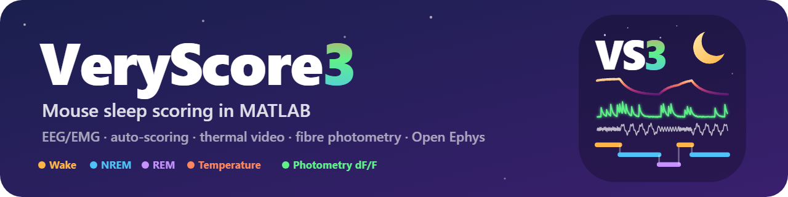

# VeryScore3

This software allows you to score mouse sleep (wakefulness, NREMS, REMS) in 4 second epochs.

VeryScore3 is the continuation of **VeryScore2**, written by Romain Cardis and Anita Lüthi in the Lüthi lab (University of Lausanne), with later updates by Georgios Foustoukos. It opens the same files and saves the same scoring, so files can go back and forth between VeryScore2 and VeryScore3. What is new:

- **Auto-scoring** that learns from scored recordings and adapts to each new one (about 90 % agreement with a human scorer, as good as a second human)
- **Thermal video**: the temperature of the animal from an Optris thermal camera, in a panel above the hypnogram
- **Photometry**: dF/F of a fibre photometry channel recorded with the EEG
- **Video**: the Raspberry Pi camera and the thermal camera in a column next to the traces, at the epoch you score, played over its 4 s, one above the other or the thermal image over the camera, with ROI traces
- **Sensor data**: the respiration / heart sensor of the Pi compared with the EEG / EMG in each 4-s epoch
- **Open Ephys**: recordings converted into VeryScore files from the File menu
- **Summary figure**: hypnogram, EEG sigma activity, temperature and photometry of the whole recording
- Everything in one program, `VS3_main`. See CHANGELOG.md for the full list.

_Dedicated to Romain Cardis and Anita Lüthi, who wrote VeryScore2 and shared it with all of us._

## Installation

1. Add the folder `VeryScore3_For_Sleep_Scoring` to the MATLAB path (the subfolders are added by the tools when they need them).
2. Type `VS3_main`: the start screen shows the logo and what to do first. Import a file in the "File" menu.

Requirements: MATLAB R2022b or newer (tested with R2024b), Signal Processing Toolbox. The videos are read by MATLAB itself (no Python, no toolbox). Optional: Parallel Computing Toolbox (faster thermal video analysis), Image Processing Toolbox (only for the `shavedPatch`, `mouseBody` and `hottestBlob` thermal ROI methods), Python 3 with `numpy` and `h5py` (only to convert thermal videos). The Statistics toolbox is not needed.

If VeryScore2 is also on your MATLAB path, remove it: both have files with the same names (the thermal code, `renameFileToBt`, ...).

## Files

Simply launch VS3_main and import a file obtained with Simply2Read (or any .mat file in the same format) in the "File" menu. Open Ephys recordings are converted first with **File > Convert Open Ephys recording...** (see **Open Ephys recordings** below).
The files should be named like this:

AnimalName_recordingNumber_condition_t.mat

A file holds the variable `traces` (one row per channel) and a structure `Infos` with at least the sampling rate `Infos.Fs`. Optional: `Infos.Channel` or `traceName` (channel names), `Infos.StartTime` (time of the first sample, used to align a thermal video). VeryScore3 saves the scoring as `b` (one letter per 4-s epoch) and `bTrans`, the temperature as `Thermal`, the dF/F as `Photometry`, the videos shown next to the traces as `Video` and the sensor settings as `Sensor`, all in the same file.

Your raw traces now appear.

**Important notice: All the display changes you will do on the traces, such as filters, gain changes or supressing traces are not saved in the file. The only thing saved is the b string containing your scoring (and the Thermal and Photometry results when you compute them). This means you should not be afraid to make display changes to ease your scoring. To keep the traces as you see them, use File > Export displayed traces: they go to a new file, the scored file is not touched.**

**Second notice: In the lab we are using super nintendo USB controllers to score. Coupled with a small software such as JoyToKey, you can score much faster and more confortably (https://joytokey.net/en/). We provide a configuration for JoyToKey that is prepared for super nintendo controllers in the VeryScore3 folder (JTK_scoring.cfg).**

## Naming your traces
It is advised at this step to give names to your traces, especially if you have more than 2. To do so, you need to go into:

File > Edit file Infos

There you should choose to create a **New** field.

The new field name SHOULD be: **Channel**
now in the Field content put the trace labels between commas such as: EEG, EMG, S1, CA1
You can name them whatever.

Now go to:

**Tools > Reload Names from Infos**

You should see the names on the right of the traces.

Before Scoring:

You can select the traces by clicking on them. The selected ones are orange.

Once selected, you can filter the trace(s) in the menu **Traces > Filter traces**

If your EMG or EEG is composed of two traces, you can "bipolarize" them to get the difference betweem the two.

Select two traces > **Traces > Bipolarize**

This simulates a referencing of one to the other.

To auto-score the file: **Tools > Auto-Scoring > Score this file...** (see **Auto-scoring** below), then correct it.

## Moving around and scoring

Left: **a**

right: **d**

next transition to the left: **left arrow**

next transition to the right: **right arrow**

increase gain of all traces: **up arrow** (when none selected or of the selected traces only)

decrease gain of all traces: **down arrow** (when none selected or of the selected traces only)

WAKE epoch: **w**

NREM epoch: **n**

REM epoch: **r**

WAKE artifact: **1**

NREM artifact: **2**

REM artifact: **3**

Microarousal: **m**

Whatever purple epoch: **f**

Moving the selected trace up and down in position: **shift+arrow**

Next epoch of a state: **shift+w**, **shift+n**, **shift+r**, **shift+m**, **shift+f**, and **shift+b** for the next unscored epoch (the uncertain epochs left by the auto-scoring)

## Advanced functions

**File >**

**Import:** Let you import a new file.

**Convert Open Ephys recording...:** converts Open Ephys recordings into VeryScore files, see **Open Ephys recordings** below.

**Import randomly:** Let you select multiple files and give them for you to score in a random order without knowing which one. This is very useful in case you need to score your files in a blind manner. We are all subjected to treatment biases so doing this removes this concern.

**Save:** Save your current scoring. The file will then receive a **b** in its name to show that is contains scoring data (`name_t.mat` and `name.mat` become `name_bt.mat`). If you load that file again, the saved scoring will appear.

**Export displayed traces (.mat)...:** saves the traces as you see them (filters, notches, bipolar traces, the photometry dF/F; in the order of the screen, without the suppressed traces) in a new `.mat` file, for analyses outside VeryScore3. You choose the name and the folder, then the names of the channels (leave a name empty to leave that trace out) and the start time. The file holds:
- `traces`: one row per channel at 200 Hz (the rate of the display), in the units of the recording: the display gain and the scaling done at loading are undone. The dF/F is in %, NaN in the first and last seconds where there is none.
- `traceName`: the names of the channels.
- `traceProcessing`: what was done to each trace (source channel(s), filters in the order applied, dF/F method).
- `Infos`: `Fs` (200), `StartTime` (time of the first sample), `Channel`, `ChannelUnits`, `Source` (the scored file).
- `SourceInfos`: the `Infos` of the scored file.

The exported file opens in VeryScore3 like any other file. The scoring is not in it; it stays in the `_bt.mat` file.

**Edit file Infos:** This allows you to add field to the Infos structure contained in the file. You can precise treatments, important time points, or whatever you would like to use for future analysis with this file. Like mentionned above, you can create the field **Channel** to add names to your traces. An idea is to put the name of the person that did the scoring.

**Reduce file size:** We noticed that loading the whole file and saving it again all in one shot sometimes reduces the file size. If size is a problem for you, you can try this function once you have a file loaded.

**Rename files to bt:** renames recordings named like `date_name1_name2_name3_name4_condition_AnimalN_n.mat` (Symply2Read) to `name_0n_condition_t.mat`.

**Tools >**

**Auto-Scoring:** score the file automatically, teach the auto-scoring with your corrected scorings, or run the classic autoscoring of VeryScore2. See **Auto-scoring** below.

**Reload Names from Infos:** Once the field **Channel** exists in Infos and contains the trace names, you can load the names for them to appear on the chart.

**Take a snapshot:** It takes a snapshot of the current window, essentially reploting the current view in a new figure. You can then save the figure to keep track of your nicest spindles or show irregularities to your collegues.

**Summary figure...:** the whole recording in one figure: the hypnogram, the sigma activity of an EEG channel, the temperature and the photometry dF/F when the file has them, and the time spent in each state. See **Summary figure** below.

**Thermal video:** see **Thermal video** below.

**Photometry:** see **Photometry** below.

**Traces >**

**Lock YLim:** The Y-limit of the chart is dynamically updated to see all the traces. While scoring, you sometimes have big artifacts that would mess up the view. You can lock the YLim for it not to move. It is then more confortable to score.

**Filter traces:** Allows to apply filters to selected traces. Three filters are available: >0.75 Hz, >25 Hz, <25 Hz. We typically filter >0.75 Hz for EEGs and LFPs and >25 Hz for EMGs.

**Bipolarize:** Create a new trace from the difference of two selected traces. You can choose to keep the two original or not.

**Change gain * 1000:** This allows to change the gain massively, instead of using the arrows up and down.

**Notch:** Apply a notch on the selected traces. You can use 50 hz or 60 hz notches. We record our animal within faraday cages so we usually don't require notches.

**Supress selected traces:** If a specific trace in not needed for your scoring, or you want to not see a stimulation trace, you can select it and supress it from the display. The trace will still exist in the file and would appear if you load it again.

**Swap traces positions:** Select two traces and swap their position on the display. This change will not affect the ordering of the channel within the file. This is for display purpose only.

**Reverse gain and filter:** If a trace is unreadable due to a false manipulation or if you want to reset it to raw data, you can reverse the changes made to it.

**Reverse all changes:** Returns the display of the traces to the original state at the moment of loading the file. This will not affect your scoring, it reverses only the display (the dF/F and the temperature panel are shown as at loading; the transitions you placed by hand are kept).

**Help >**

**About VeryScore3...:** version, credits (VeryScore2 by Romain Cardis and Anita Lüthi, VeryScore3) and links to the repositories.

**Width >**

This menu allows to change the view window to zoom in or out on the x-axis. I prefer to score in 40 s-windows, Alejo prefers in 32 s-windows for example.

## Auto-scoring

**Tools > Auto-Scoring > Score this file...** scores wake, NREM and REM in about 2 s for 8 h of recording (`VS3_autoScoreTool.m`).

1. Choose the EEG channel(s) and the EMG channel(s), one or two of each. No filtering is needed first. The choice is remembered for files with the same channel names. With no remembered choice: the channels named EEG / EMG, otherwise EMG = channels 1-2 and EEG = channels 3-4.
2. If the file already contains a partial scoring, tick **Keep the epochs already scored and learn from them**: they stay as they are and the model is calibrated on them. Scoring the first 30 min by hand before launching it helps a lot on a new animal or setup.
3. Epochs where the model is not sure (probability < 0.6) stay unscored (**b**, blue). **shift+b** jumps to the next one. Then check the transitions with the arrows as usual.

How it works: for every 4-s epoch, the EEG power in 8 bands (0.5-45 Hz) and the theta/delta ratio are computed for each EEG; the EMG RMS above 30 Hz (with 50/60 Hz notches) for each EMG and for the difference of the two EMGs, which cancels the EEG picked up by the neck electrodes. The features are normalized within the recording and the two epochs before and after are added as context. A linear discriminant model is trained on a library of manually scored recordings; the muscle tone, which is bimodal (awake / asleep) in every recording, vetoes its obvious mistakes; the model is then trained again on the library plus the confident epochs of the recording, so that it adapts to the animal, the electrodes and the amplifier.

**The library.** VeryScore3 comes with 4 recordings (mice Os21 and Li15, 8 h each, manual scoring by AO) in `autoscore/VS3_autoLibrary.mat`. **Add this scoring to the library...** adds the file you just corrected to your own library (`autoscore/VS3_autoLibrary_local.mat`, not shared through git), so that the auto-scoring learns your animals, electrodes and scoring style. **Library contents...** lists all recordings and lets you remove yours.

Validation: each recording scored with a library made without it, compared with the manual scoring (AO).

| | agreement | kappa | REM F1 |
|---|---|---|---|
| Auto-scoring, 2 EEG + 2 EMG | 89.8-92.9 % | 0.82-0.87 | 0.87-0.93 |
| Same, library from the other mouse only | 82.8-93.5 % | 0.69-0.88 | 0.79-0.92 |
| Auto-scoring, 1 EEG + 1 EMG | 86.7-89.6 % | | |
| Second human scorer (JF) | 87.9-93.0 % | 0.79-0.88 | 0.56-0.84 |
| Classic autoscoring (VeryScore2) | 56.7-79.1 % | 0.29-0.63 | 0.13-0.41 |

See `autoscore/validation_200124_Os21_BL1.png`. Artifacts (1/2/3) and microarousals (m) are not detected: they are scored as their state.

**Classic auto-scoring (VeryScore2, selected traces)...:** the autoscoring of VeryScore2: filter the EEG over 0.75 Hz and the EMG over 25 Hz, select both EEG and EMG, then launch it. Its blue epochs are _unknown_ and represent potential changes during long NREMS sleep bouts. This is oversensitive on purpose and allows not to miss any events such as microarousals.

## Thermal video (temperature panel)

If the animal was filmed with an Optris thermal camera (PIX Connect `.ravi` recording) during the EEG recording, VeryScore3 extracts the temperature of the animal from the video and shows it in a panel just above the hypnogram, on the same time axis. The panel shows the value of every video frame (grey), the mean per 4-s epoch (red), the current position and, on the right, the temperature of the epoch you are scoring. Clicking in the panel navigates like the hypnogram.

**Tools > Thermal video >**

**Analyse video (.ravi / .h5)...:** Select the `.ravi` of the loaded recording (or a `.h5` already converted) and fill in the options: ROI method, number of hottest pixels averaged (N), and the video/EEG offset in seconds or as the EEG start time. The tool then:

1. converts the `.ravi` once into a compact `.h5` next to it (Python, a few minutes, progress bar with cancel). If the `.h5` already exists it is reused.
2. extracts one temperature per frame with the ROI method (`hottestN` = mean of the N hottest pixels of the frame, default N = 50; `shavedPatch` follows the shaved skin of the animal, the most sensitive measure on a shaved animal (wake - NREM 0.83 K on bare skin against 0.32 K through the fur on AH2); `mouseBody` measures the whole segmented animal; `hotspotWindow` and `hottestBlob` are more robust when several warm objects are in the image; your own methods go in `thermal\roi_methods\roi_<name>.m`). About 1 min for a 5-h video; with the Parallel Computing Toolbox (used automatically for videos longer than about 3 h) about 30 s the first time in a MATLAB session, while the workers start, and about 10 s afterwards.
3. puts the values on the time base of the scoring (one value per 4-s epoch, same indexing as the scoring string `b`), checks with the movement seen in the video whether the offset agrees with the wake epochs, and stores everything as the variable **Thermal** in the scoring file (`Thermal.valueEpoch`, `Thermal.t2Hz` / `Thermal.value2Hz` per frame, `Thermal.valueFs` per EEG sample, `Thermal.unit`, `Thermal.offset`, ...).

The next time the file is loaded, the panel appears automatically.

With `shavedPatch` and `mouseBody` the frames in which the animal moves (more than 0.5 pixel per frame, option `speedThr`) are dropped and the temperature is interpolated over them; the number of dropped frames is reported and stored as `Thermal.motionCensor`. During long active periods a large part of the frames can be dropped, so there the trace is mostly interpolation.

Reading the panel: during wake the value also follows the movement of the animal. A moving animal smears the hottest pixels of the 2-Hz frames and looks colder (in our recordings still wake was warmer than NREM, moving wake colder), so compare states with this in mind.

**Show temperature panel:** hide or show the panel (the data stay in the file).

**Change video/EEG offset...:** the offset is the video time (seconds since the first frame) at which the EEG recording started: 0 when both were started together, positive when the EEG started after the video. You can also type the EEG start time instead. Changing it re-aligns the stored values without touching the video.

**Alignment from timestamps.** The video knows when it started (the camera metadata holds the clock of the recording PC). If the scoring file knows when the EEG started, the offset is computed for you: `Infos.StartTime` (written by Open Ephys converters, or added with File > Edit file Infos, e.g. `2026-09-07 12:44:07`), or the Intan time token in the file name (`..._260907_124407_...`), or typed in the dialog. A date without time of day is not used, and a start time more than 12 h away from the video start is ignored with a warning. Otherwise the tool uses the offset of the previous analysis of the file, or assumes both recordings were started together (offset 0) and checks that against the movement in the video. The two computers' clocks must agree for this to be exact.

**Estimate offset from movement:** cross-correlates the movement of the hot spot in the video with the wake epochs of your scoring and proposes the best offset (score the file first, at least roughly). Its resolution is a few seconds: when the offset comes from the start times of the two recordings, keep it.

**EEG start time from Open Ephys recording...:** select the `sync_messages.txt` of the Open Ephys recording the file was made from (`<recording>\experiment1\recording1\sync_messages.txt`). The exact time of the first EEG sample is computed from the software time written there and stored as `Infos.StartTime`, and the temperature is re-aligned with the offset that follows from it and from the video start time.

**Add camera calibration (degC) to video...:** the `.ravi` contains energy counts, not degrees. Without the characteristic curve of the camera (`Kennlinie-<serial>-<lens>-M20-100.prn`, kept by PIX Connect in `%APPDATA%\Imager\Cali` on the recording PC) the panel shows counts, which are proportional to the temperature (about 40 counts per kelvin). Use this item once you have the file: it is copied into `thermal\calibration`, added to the `.h5`, and the analysis is run again in degC.

**Select python.exe...:** the conversion needs Python 3 with `numpy` and `h5py` (`pip install numpy h5py`). Python is looked for automatically the first time and remembered; use this item to point to another one.

The analysis code is in the `thermal` folder (`ThermalH5`, `thermal_roi_timeseries`, `thermal_align_to_eeg`, `estimate_offset`, `roi_methods`, `python`), the tool that drives it from the menu is `VS3_thermalTool.m`.

## Video (Pi camera and thermal camera next to the traces)

When the animal was filmed during the EEG recording, the videos can be watched next to the traces while you score. Open a video and a column appears right of the traces (they get narrower); close the last video and the column disappears. The column shows the frame at the start of the epoch you are scoring and follows every move of the main window (keys, clicks in the hypnogram, the summary figure...).

**Tools > Video >**

**Open Pi camera video...:** the video of the Raspberry Pi camera (`.mp4`, `.avi`), with its `<name>.timestamps.csv` next to it: the time of every frame (`video_pts_us`) and the clock time of the first one (`estimated_utc`). The frames are found by these times, not by a frame rate, so a video whose frame rate varies stays exact. Without the timestamps file the nominal frame rate is used and you are told.

**Open thermal video (.ravi / .h5)...:** the `.ravi` of PIX Connect read directly (energy counts; nothing to convert), or the `.h5` made by Tools > Thermal video (degrees when the camera calibration was added). When the temperature of this video was analysed, its offset is used.

**Show:** Pi camera, Thermal, Pi and thermal (one above the other), or **Thermal over Pi**: the thermal image laid over the camera, its warm parts opaque and the cold ones transparent (slider in the column for the opacity). The same choice is in the column.

**Align thermal on Pi camera...:** click at least 3 points that you can find in both videos (corners of the cage, the head...) on the camera, Enter, then the same points in the same order on the thermal video: the thermal image is moved, scaled and turned onto the camera (with more than 3 points the remaining error is reported). Until then it is simply fitted into the camera image.

**Play 4 s** (button of the column, or the **space bar**): plays the 4 s of the epoch at the real speed (or 0.5x, 0.25x, 2x), with a black line running over the traces at the time of the frame. The scoring keys keep working after a click in the column.

**Change video/EEG offsets...:** as for the temperature, the offset is the video time (seconds) at which EEG sample 1 was recorded: positive when the EEG started after the video. It is computed from the start times of the recordings: for the Pi camera the clock time of its first frame (UTC) against `Infos.StartTimePosix` (written by File > Convert Open Ephys recording; else `Infos.StartTime` in the time zone of the file), for the thermal video its start time against `Infos.StartTime` (clocks of the PCs; start times more than 12 h apart are not used). Type another value to correct it; leave the field empty to compute it again. The offset and where it comes from are shown above the videos.

**Load recorder timing folder...:** the folder written by the recorder for a saved recording (`manifest.json`, `quality.json`, `evidence.jsonl`, `thermal-frame-times.csv`, `thermal-eeg-alignment.csv`, `thermal-eeg-quality.json`): it maps every frame onto the EEG instead of a single offset, from the observations of the camera clock by the PC (Pi camera) and the EEG sample number of every thermal frame (thermal camera, found by the rate, first sample, length and start of the EEG). Frames without a valid clock observation are not shown. These are estimates of the software clocks: the latency of the cameras, the drift of the EEG and the averaging of the thermal frames are not measured. **Clear recorder timing** goes back to the offsets.

**Add ROI...:** draw a rectangle (two opposite corners) on the camera or on the thermal video. For every frame of the epoch a Pi ROI gives its movement (dx, dy in pixels, tracked from frame to frame from its place in the first frame of the epoch) and its brightness, a thermal ROI its mean (degrees or counts). The traces of the epoch are drawn under the videos with the amplitude spectrum of the one you click (respiration of a sleeping mouse, about 3 Hz, appears in the dy of a ROI on the flank). **Measure ROIs at every epoch** (on by default) measures them at each new epoch: about 1-2 s for the 120 frames of a Pi epoch; switch it off to score faster and use **Measure ROIs of this epoch**. **Remove ROIs...** removes some of them.

**Close Pi camera video / Close thermal video.**

**Save** stores the videos, their offsets, the view, the alignment of the thermal image and the ROIs as the variable **Video** in the scored file: the next time the file is loaded the videos are opened again (a video that was moved is also looked for in the folder of the scored file). The videos themselves are never written. In blind mode (Import randomly) the column shows no file name.

The code is in `VS3_videoPanel.m` (the column), `VS3_video.m` (reading the frames: `V = VS3_video(file); img = V.frame(k); k = V.frameAt(t)`) and `VS3_videoTiming.m` (the recorder timing maps). From a script: `VS3_main(file, 'pi', piVideo, 'thermal', thermalVideo)` opens a file with its videos.

## Sensor data (Pi sensor and EEG / EMG)

**File > Sensor CSV files to one H5...:** the CSV / CSV.GZ files of one recording of the Pi sensor, selected in chronological order, are put together in one `.h5` (the raw ADC values, the acquisition time of every sample, the gaps, a quality flag per sample: clipping, steps, timing, warm-up, demo; nothing is filled in). The CSV files are not changed and an existing `.h5` is never overwritten. From a script: `VS3_sensorConvert({'recording_PWM.csv'}, 'recording_sensor.h5')`.

**Tools > Sensor data > Import sensor H5...:** with the EEG file open, select the `.h5` and the traces to compare it with (each shown with its name and the name of its recorded channel, for example `EMG_A | original: CH6`; Ctrl for several). The comparison window opens on **Full recording**: for every 4-s epoch the strongest peak of the sensor and of each trace in the respiration band (0.5-5 Hz) and in the heart band (5-15 Hz), in Hz (left axis) and per minute (right axis), with x marks where the heart peak can be a harmonic of the respiration. Click a point to see that epoch in **Current 4 s - waveforms & FFT**: the sensor (low-pass 20 Hz, zero-phase) and the traces as displayed in the main window (filters, notches, differences kept, display gain undone), with their amplitude spectra (Hann window, 0.25-Hz resolution). The window follows the epoch of the main window, and Previous / Next move both.

The sensor is aligned with the EEG by the clock times: **sensor start minus EEG start** (positive when the sensor started later), from the first UTC time of the CSV and `Infos.StartTimePosix`; **Alignment and candidate bands...** changes it and the bands. The accuracy of these clocks has not been measured. Epochs with missing samples, clipping, steps or flags give no value. **Save** stores the `.h5`, the offset, the bands and the traces compared as the variable **Sensor** in the scored file; keep the `.h5` next to it. The bands are search ranges, not physiological limits, and a peak in the EMG is not a detected heartbeat.

The code is in `VS3_sensorConvert.m`, `VS3_sensorTool.m` and `VS3_sensorView.m`.

## Photometry (dF/F)

Fibre photometry recorded on an analog input (for example `ADC1` of an Open Ephys board, with the two LEDs modulated at 217 and 322 Hz) is stored in the file as the raw detector signal. On screen that trace looks flat: VeryScore3 downsamples every trace to 200 Hz for display, which removes the LED carriers. The photometry tool reads the channel from the file at its full sampling rate and turns it into dF/F.

**Tools > Photometry >**

**Selected trace to dF/F...:** click on the photometry trace so that it is orange, then choose this item. You are first asked which baseline F0 to use, because it depends on the sensor:

- **Purple signal (405 nm):** F0 is the purple channel fitted onto the signal (linear fit, leaving out the first 600 s). It removes bleaching and movement together, and is the right choice for sensors whose 405 nm response does not depend on the ligand.
- **Exponential decay:** F0 is a double-exponential bleaching fit of the signal itself (robust fit on its 1-Hz means, leaving out the first 300 s). The purple channel is treated the same way and only kept as a control.

Then you can check the carrier frequencies (217.38 Hz for the 465 nm LED and 322.57 Hz for the purple one; the exact values are measured in the data within 2 Hz) and the time left out at the start. The choices are remembered for the next file. The dF/F of the time left out at the start is an extrapolation of the baseline; you are warned when the bleaching fit is poorly constrained (a time constant at its limit). The exponential decay needs at least 20 min after the time left out.

The selected trace is replaced by the dF/F and its name gets the suffix `dF/F`. On screen it is scaled so that its typical variation within one minute fills about one trace slot, and it is centred in its slot on every screen (its slow drift over the night is left out of the display only; the values in the file are not changed). Select it and use the up/down arrows to change its gain. A file holds the dF/F of one photometry channel: computing another channel replaces it (you are asked first). The values in % are stored in the file as the variable **Photometry** (`Photometry.time` in seconds since the first sample, `Photometry.dff` in % at 20 Hz, `Photometry.signal` and `Photometry.iso` the two carrier amplitudes in V, `Photometry.baseline`, `Photometry.dffIso` the purple control, `Photometry.method`, `Photometry.fit`, ...). The next time the file is loaded, the dF/F is shown in place of the raw channel. **Traces > Reverse gain and filter** shows the raw trace again.

**Show dF/F overview figure:** the carrier amplitudes with the fitted baseline, the dF/F and the purple control over the whole recording. Look at it once per recording to check the fit.

How it is computed: the channel is multiplied by the cosine and sine of each carrier, low-pass filtered (2-s Kaiser filter, 8 Hz) and decimated to 20 Hz; the amplitude of each LED is `2*hypot(I, Q)`; dF/F = 100 × (signal − F0) / F0. The tool refuses a channel without carrier, and a detector output stuck at the ADC ceiling (4.59 V). Files whose ADC channels were stored a million times too small by an early Open Ephys converter (September 2026) are recognised and corrected before computing. The code is in `VS3_photometry.m`; `VS3_photometry('compute', x, fs, 'method', 'purple')` runs the computation on a signal in volts (add `'volts', false` for other units).

## Summary figure

**Tools > Summary figure...** asks for the EEG channel of the sigma activity (the one chosen for the auto-scoring is proposed) and draws, on one time axis (hours since the first sample; panels zoom together):

1. the hypnogram (wake, NREM, REM; artifact epochs with their state, microarousals as marks above wake)
2. the sigma activity: power of the EEG in the sigma band (10-15 Hz) in every 4-s epoch, in % of its mean over the NREM epochs (of the median when nothing is scored as NREM); NREM in green, as a 3-epoch moving median that keeps the slow (about 1-min) fluctuations of sigma, over the values of each epoch in light green; artifact epochs left out
3. the temperature of the thermal video, when the file has it (one value per epoch, per video frame in grey)
4. the photometry dF/F, when the file has it (20 Hz in grey, 10-s mean in blue; the start left out of the baseline fit shaded)

and, on the right:

- when the recording ran (date, start and end clock time, duration), how much is scored and asleep, microarousals, artifact and unscored epochs
- a ring of the time spent in wake, NREM and REM (% of the scored time, minutes, number of bouts)
- the duration of every bout of each state: box plots (quartiles, + mean) over the individual bouts, on a log time axis
- the states hour by hour (stacked bars, labelled with the clock time; a last part shorter than 15 min is left out)

Clicking in the figure shows that moment in the main window.

**Summary > Save as .fig and .png...** saves it next to the recording (`<name>_summary.fig` and `.png` are proposed). The `.fig` opens in MATLAB (double-click it, or `openfig`) with the panels still zoomed together, also on a computer without VeryScore3: zoom on any part of the night and all panels follow. The figure's own File menu exports other formats (pdf, svg...). In blind mode (Import randomly) it shows neither the file name nor the date. From a script: `[fig, S] = VS3_summary('b', b, 'eeg', x, 'fs', 200, ...)`, where `S` holds the plotted series and the statistics.

## Open Ephys recordings

**File > Convert Open Ephys recording...** converts recordings of the Open Ephys GUI (binary format, versions 0.6 and 1.x) into VeryScore files. Select the folder of the session (every recording found below it is converted, whatever the folder layout, several Record Nodes included; a Record Node, experiment, recording, `continuous` or stream folder works too) and the folder for the converted files. When there are several recordings you choose which ones in a list, then the channels to convert (all are selected; memory monitoring is never converted). When some recordings are already converted in the target folder you are asked whether to skip them or convert them again. Each recording becomes `<name>_<yymmdd>.mat` with:

- `traces`: the chosen channels raw, in volts (headstage channels and ADC inputs, for example a photometry detector), nothing filtered or rescaled; `traceName`: their names; `Infos.ConvertedChannels`: their numbers in the recording
- `Infos`: sampling rate, channel names and units, the exact time of the first sample (`Infos.StartTime`, clock of the recording PC, used to align a thermal video), dropped samples, Open Ephys version, machine, ...
- `Events` and `Messages` when TTL events or messages were recorded

When one recording was converted, you can open it right away. An 8-h recording with 5 channels takes about 20 s. From the command line: `VS3_convertOpenEphys(sessionFolder, targetFolder)` (options `'unit'` `'V'` / `'uV'`, `'overwrite'`, `'channels'` names or numbers).

The channels of the Open Ephys acquisition board each have their own DC level: in files converted from it (`Infos.Stream` = `acquisition_board`) every trace is centred in its slot on screen. The values, filters and exported traces are not changed. Older converted files whose `Infos.Channel` lists the whole recording while only some channels were kept are named from `traceName`. The `.npy` files of the recording are read by VeryScore3 itself (no npy-matlab needed).

## Credits

- **VeryScore2** (2018-2021): Romain Cardis and Anita Lüthi, Lüthi lab, Department of Fundamental Neurosciences, University of Lausanne, with updates by Georgios Foustoukos (2023-2024). VeryScore1's autoscoring is kept as the classic auto-scoring.
- **VeryScore3** (2026): Alejandro Osorio-Forero (Netherlands Institute for Neuroscience), written with Claude (Anthropic): auto-scoring, thermal video, photometry, unification, the video column.
- **Wenjie** (October 2026, with Codex): sensor comparison, Pi camera timestamps, direct reading of the `.ravi`, recorder timing maps, ROI tracking and the Open Ephys channel choice, first written as a separate review program and brought into the main window of VeryScore3.
- The logo (`images/`, drawn by `images/VS3_makeLogo.py`) appears on the start screen, in the progress windows, in Help > About and in the summary figure.
- If you use VeryScore in published work, please cite the Lüthi lab as described in the README and CITATION.cff at the root of this repository.

**In the name of the Lüthi lab, we wish you a good scoring!**
