
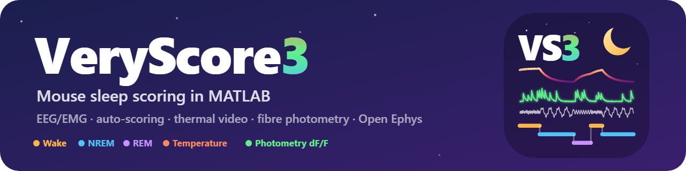

# VeryScore3 tutorial

This tutorial takes you through VeryScore3 step by step. It starts with a raw Open Ephys recording and ends with a scored file, with the videos of the animal next to the traces. It is written for students and anyone who opens VeryScore3 for the first time. Every menu is explained in more detail in the [README](../README.md).

**Watch the video tour first:** [VS3_tour.mp4](https://github.com/aosorioforero/VeryScore3/releases/download/tutorial-video/VS3_tour.mp4) (10 min 48 s, 1080p, 221 MB). It shows everything below in the real program, filmed on the recording of this tutorial. Chapters:

| | | | |
|---|---|---|---|
| 0:06 | Open a recording | 4:51 | Videos next to the traces |
| 0:59 | The main window | 5:52 | Put the videos on the EEG time |
| 1:43 | Prepare the traces | 7:53 | ROIs: movement and breathing |
| 2:52 | Score by hand | 8:44 | Sensor data |
| 3:42 | Auto-scoring | 9:30 | Summary figure |
| 4:26 | Save | 9:52 | More tools |

All figures come from the same real recording: one mouse, 29 October 2026, 08:00 to 13:00. It has two EEG and two EMG electrodes recorded with Open Ephys at 1 kHz, a Raspberry Pi camera above the cage, an Optris thermal camera, and the respiration / heart sensor of the Pi.

**Contents**

1. [Install and start](#1-install-and-start)
2. [Open a recording](#2-open-a-recording)
3. [The main window](#3-the-main-window)
4. [Prepare the traces](#4-prepare-the-traces)
5. [Score by hand](#5-score-by-hand)
6. [Auto-scoring](#6-auto-scoring)
7. [Save](#7-save)
8. [Videos next to the traces](#8-videos-next-to-the-traces)
9. [Put the videos on the EEG time](#9-put-the-videos-on-the-eeg-time)
10. [ROIs: movement and breathing from the video](#10-rois-movement-and-breathing-from-the-video)
11. [Sensor data](#11-sensor-data)
12. [Summary figure](#12-summary-figure)
13. [More tools](#13-more-tools)
14. [Keyboard cheat sheet](#14-keyboard-cheat-sheet)
15. [Tips and common problems](#15-tips-and-common-problems)

## 1. Install and start

1. Add the folder `VeryScore3_For_Sleep_Scoring` to the MATLAB path (Home > Set Path > Add Folder). You need MATLAB R2022b or newer and the Signal Processing Toolbox.
2. If VeryScore2 is also on your path, remove it: the two programs have files with the same names.
3. Type `VS3_main` in the MATLAB command window.

The start screen tells you what to do first:

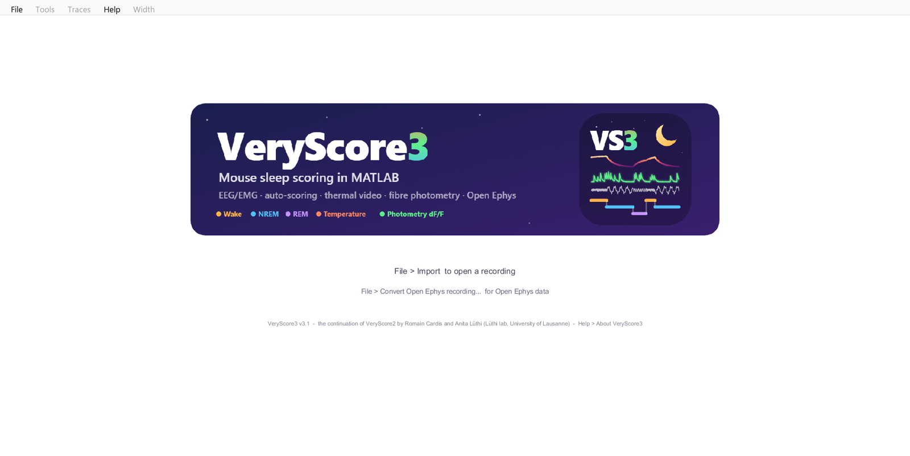

## 2. Open a recording

**A file already in VeryScore format** (`.mat` with `traces` and `Infos`, for example from Simply2Read or converted before): **File > Import** and select it.

**An Open Ephys recording** has to be converted once: **File > Convert Open Ephys recording...**

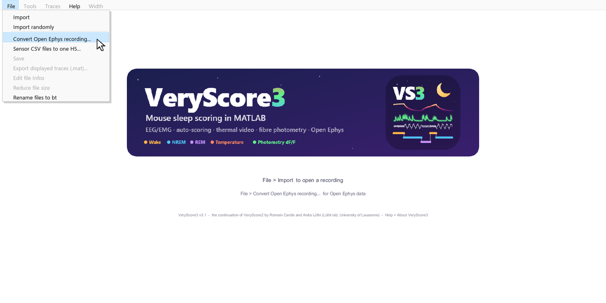

1. Select the folder of the session (the folder Open Ephys created, with the date in its name). Any folder below it works too.
2. Select the folder where the converted files go. Your own folder is best; the recording folder is never changed.
3. If the session holds several recordings, tick the ones you want. Each line shows the Record Node, the number of channels, the sampling rate and the duration.

   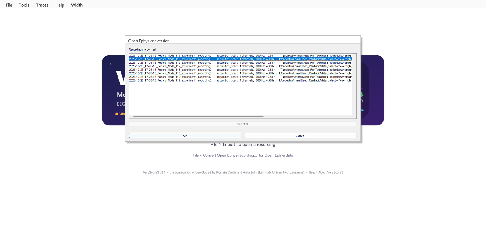

4. Choose the channels. Here the four electrodes of this mouse: CH6 and CH7 are the EMG (neck muscles), CH8 and CH12 the EEG.

   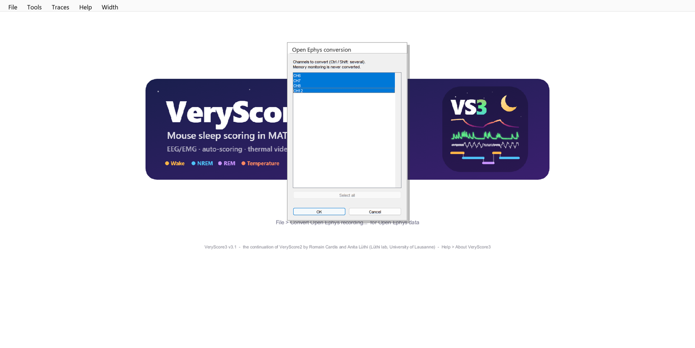

5. The conversion takes about 15 s for 5 hours at 1 kHz. VeryScore3 then offers to open the new file. It is named after the session and the date of the recording, followed by the Record Node, experiment and recording when the session holds several: here `2026-10-26_17-26-13_261029_Record_Node_116_experiment1_recording3.mat`.

The recording opens with all channels, 40 s at a time:

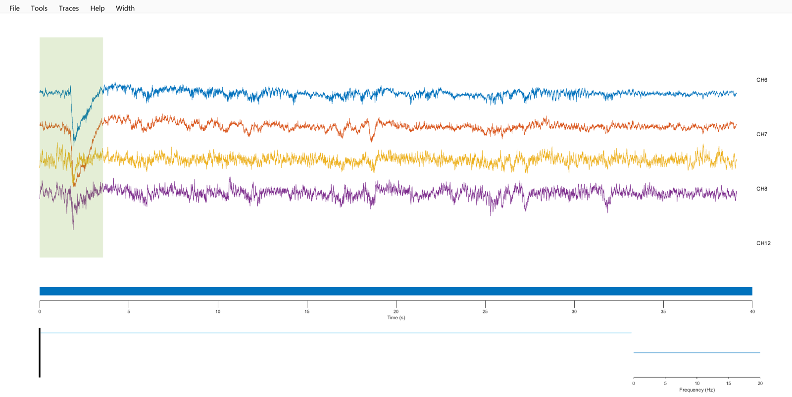

## 3. The main window

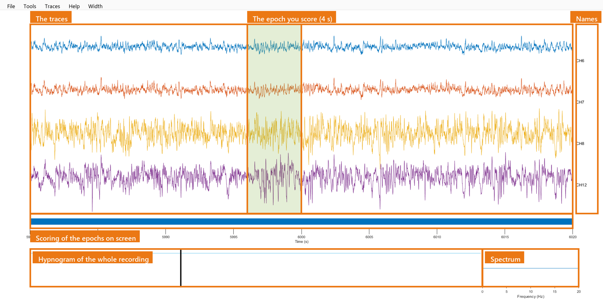

- **The traces**, 40 s at a time. The **Width** menu changes how many seconds you see.
- **The epoch you score** is the green band: 4 seconds. Every scoring key scores this epoch and moves to the next one.
- **Names** of the traces, on the right.
- **Scoring of the epochs on screen**: a coloured bar under the traces. Blue means not scored yet.
- **Hypnogram of the whole recording** at the bottom: wake on top, then NREM, then REM. The black line shows where you are. Click anywhere in it to jump there.
- **Spectrum of the epoch**, bottom right.

## 4. Prepare the traces

### Give the traces names

Names make scoring easier and are used by the auto-scoring and the summary figure.

1. **File > Edit file Infos**, then **New**.
2. Field name: `Channel`. Field content: the names separated by commas, in the order of the traces from top to bottom, for example `EMG1, EMG2, EEG1, EEG2`.

   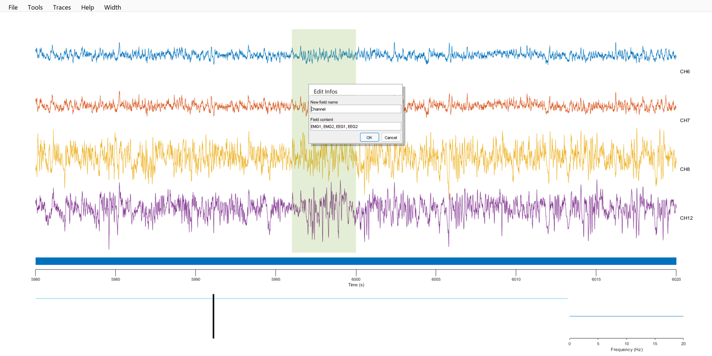

3. **Tools > Reload Names from Infos**. The names appear on the right of the traces.

### Select and filter

- **Click a trace** to select it: it turns orange. Click it again to deselect it.
- **Traces > Filter traces** filters the selected traces. Usual choices: **high-pass 0.75 Hz** for EEG and LFP, **high-pass 25 Hz** for EMG.

  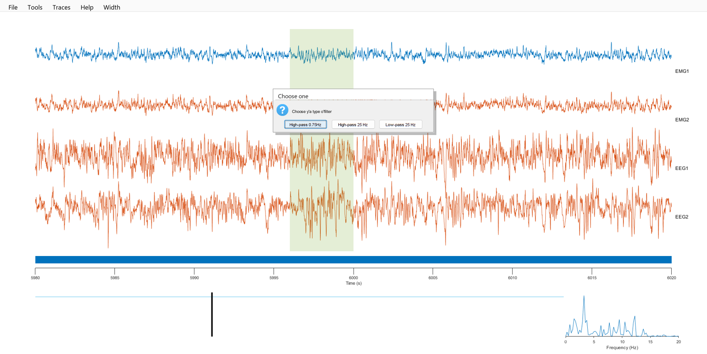

- **Traces > Bipolarize** makes one trace from the difference of two selected traces (for example two EMG electrodes).
- **Traces > Notch** removes 50 or 60 Hz mains noise.
- **Up / down arrows** change the gain of all traces, or of the selected ones only.

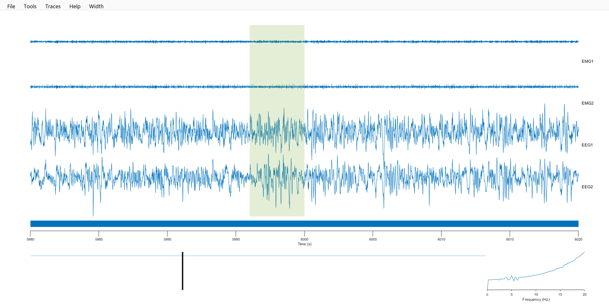

> Filters, gains, names on screen and the order of the traces are **only for the display**. They are never saved in the file, so you can experiment freely. **Traces > Reverse all changes** brings back the traces as they were at loading.

## 5. Score by hand

Look at the green epoch and press the key of its state. The epoch takes the colour of the state, and the next epoch comes.

| Key | State | Colour |
|---|---|---|
| **w** | wake | red |
| **n** | NREM sleep | green |
| **r** | REM sleep | ochre |
| **1 / 2 / 3** | artifact in wake / NREM / REM | darker red / green / ochre |
| **m** | microarousal | orange |
| **f** | anything else you want to mark | purple |
| | not scored yet | blue |

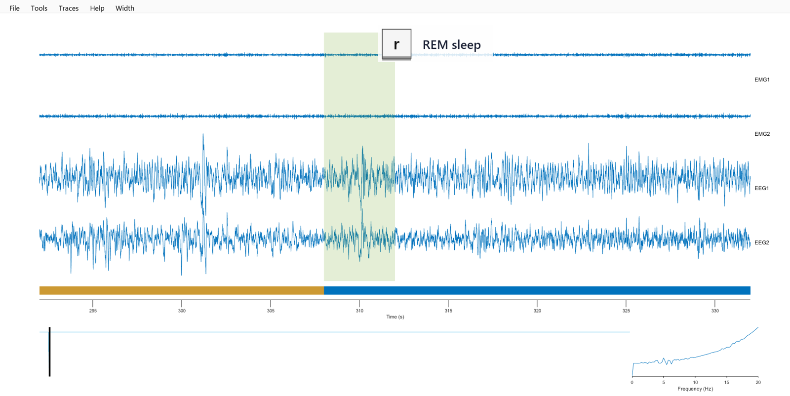

What to look for in a mouse:

- **Wake**: EMG active (tone and movements), EEG fast and low in amplitude.
- **NREM sleep**: EMG low, EEG slow and large (delta waves, 0.5–4 Hz), with spindles.
- **REM sleep**: EMG at its lowest (with twitches), EEG regular theta rhythm (6–9 Hz), usually after NREM.

Moving around:

- **a / d**: previous / next epoch.
- **Left / right arrows**: previous / next transition between states.
- **shift + w / n / r / m / f**: next epoch of that state. **shift + b**: next unscored epoch.
- Click in the hypnogram to jump anywhere.

## 6. Auto-scoring

**Tools > Auto-Scoring > Score this file...** scores wake, NREM and REM in a few seconds, with about 90 % agreement with a human scorer (as good as a second human).

1. Choose the EEG channel(s) and the EMG channel(s): one or two of each. No filtering is needed first.
2. If you have already scored part of the file, keep **Keep the epochs already scored and learn from them** ticked. Scoring the first 30 minutes by hand helps a lot on a new animal or setup.
3. **Leave uncertain epochs unscored** keeps the epochs where the model is not sure in blue, for you to check.

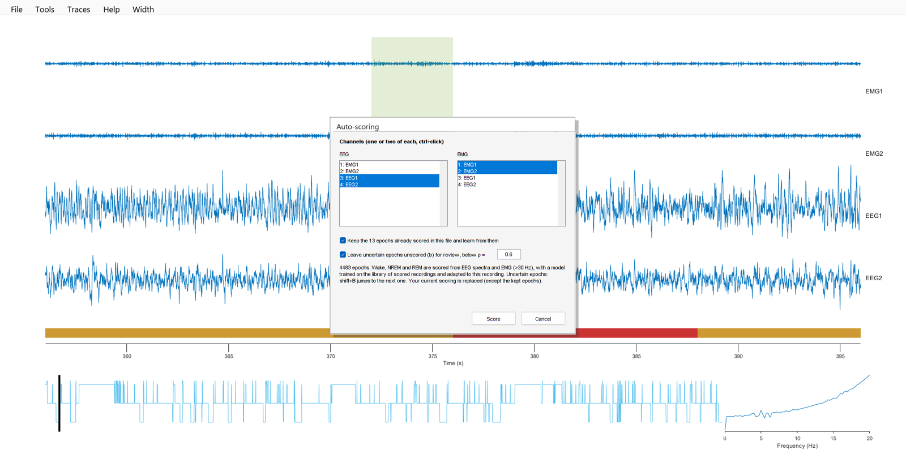

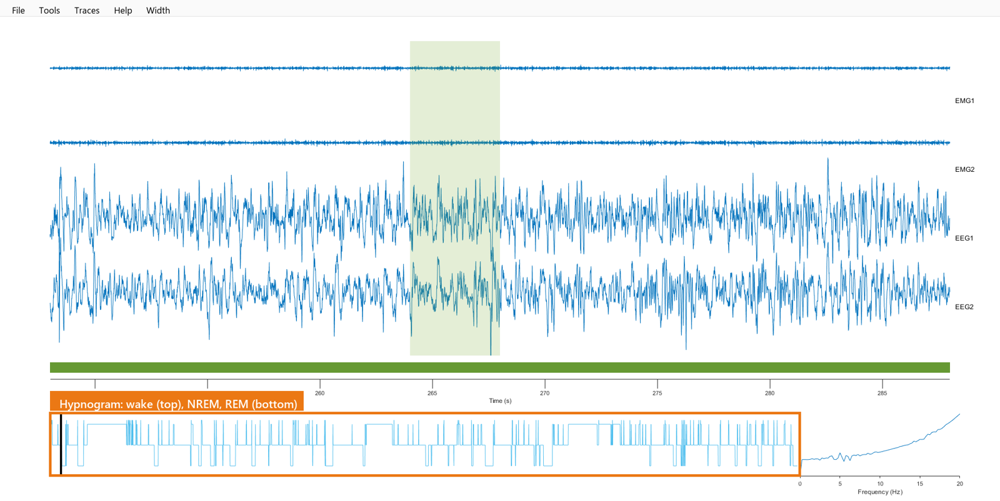

Then **check it**. **shift + b** jumps to the next uncertain (blue) epoch: score it yourself. Go through the transitions with the arrows and correct what you disagree with. The auto-scoring does not detect artifacts (1/2/3) or microarousals (m): add them by hand.

When a scoring is corrected, **Tools > Auto-Scoring > Add this scoring to the library...** teaches the auto-scoring your animals and your scoring style. It is stored in your own library and is not shared through git.

## 7. Save

**File > Save** writes the scoring into the file. The file gets `_bt` at the end of its name (here `..._recording3_bt.mat`) to show that it contains a scoring. Open it later with **File > Import**: the scoring is there, and so are the videos, their alignment, the ROIs and the sensor settings of the next sections. The traces themselves are never changed.

Save often. The scoring is the string `b` in the file (one letter per epoch), which you can load in your own analyses.

## 8. Videos next to the traces

### Open the videos

- **Tools > Video > Open Pi camera video...**: the `.mp4` of the Raspberry Pi camera. Its `.timestamps.csv` must be next to it: it gives the time of every frame.
- **Tools > Video > Open thermal video (.ravi / .h5)...**: the `.ravi` of the thermal camera (PIX Connect), read directly. You can also open the `.h5` made by Tools > Thermal video.

A column appears to the right of the traces, which get narrower. It shows the frame at the start of the epoch you score, and follows every move you make.

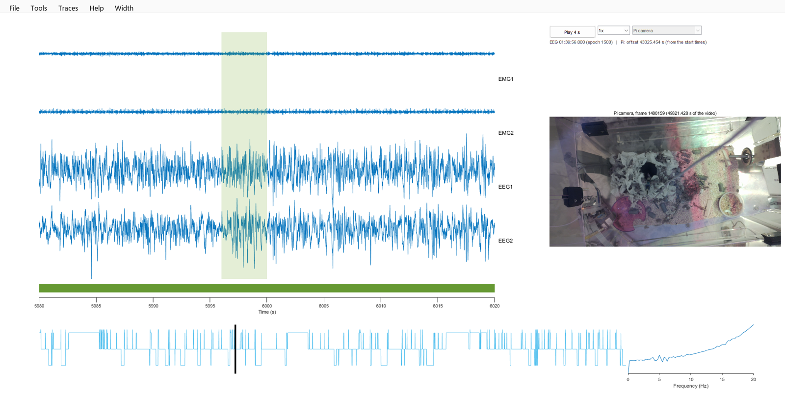

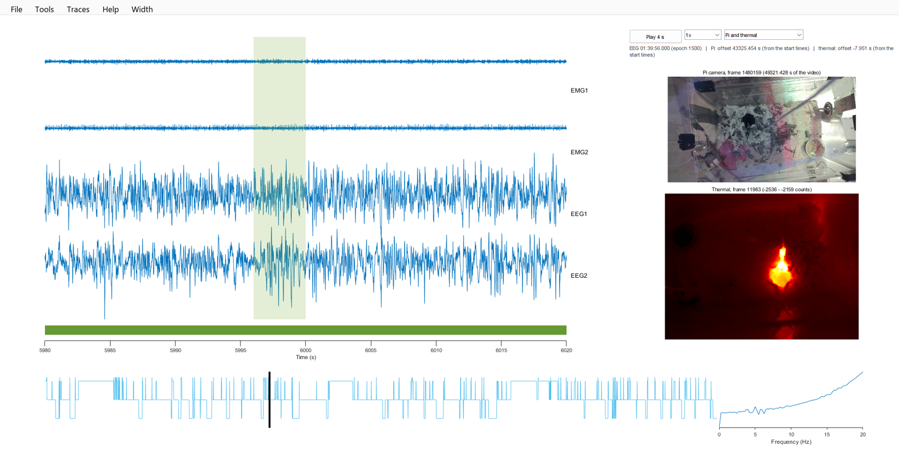

### Views and playback

- **Tools > Video > Show** (or the menu at the top of the column): **Pi camera**, **Thermal**, **Pi and thermal** (one above the other), or **Thermal over Pi** (see the next section).
- **Space bar** (or **Play 4 s**): plays the 4 s of the epoch at real speed, with a black line running over the traces. The speed menu next to it slows it down (0.5x, 0.25x) or speeds it up (2x).
- The scoring keys keep working while the column is shown.
- **Close Pi camera video / Close thermal video**: the column disappears when both are closed.

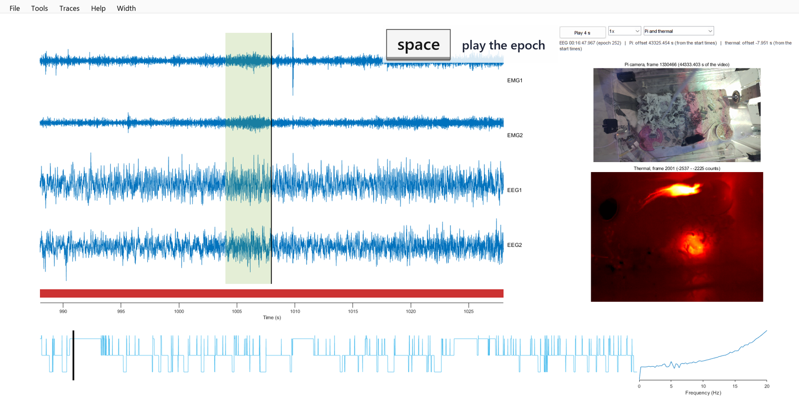

## 9. Put the videos on the EEG time

The line above the videos shows the EEG time of the epoch and **how each video is placed on the EEG**. By default this comes from the start times of the recordings, which are only as good as the clocks of the computers. **Always check it on a movement of the animal** (a wake epoch where it starts to walk) before you trust it.

- **Tools > Video > Change video/EEG offsets...**: type the offset yourself, as the video time (s) at which the EEG started. Leave the field empty to compute it again from the start times.
- **Tools > Video > Load recorder timing folder...**: if the recorder wrote a timing folder (`manifest.json`, `thermal-eeg-alignment.csv`, ...), every frame is placed on the EEG by its own clock observations instead of one offset. Here it maps the thermal video; the Pi camera has no observations in this folder.

### Estimate Pi offset from the movement

**Tools > Video > Estimate Pi offset from the movement...** checks the Pi camera against the thermal video:

1. It finds the animal (the warm spot) in the thermal video. This takes about 5 min for a 5-h video on a network drive, once per video.
2. It compares the two videos at moments when the animal starts to move after a rest, and proposes the delay.

In this recording the Pi video showed every movement 2 s late: **Correct it**. The line above the videos then says the offset was corrected from the movement.

### Thermal image over the Pi camera

**Tools > Video > Align thermal on Pi from the movement...** works out where the thermal image lies on the Pi image, from the places of the walking animal in both videos. You are shown how many moments agree and the remaining error before it is used. Here 39 of 160 moments agreed, with a remaining error of 39 pixels of the Pi camera: the thermal image is enlarged 3.44 times and turned by 178 degrees.

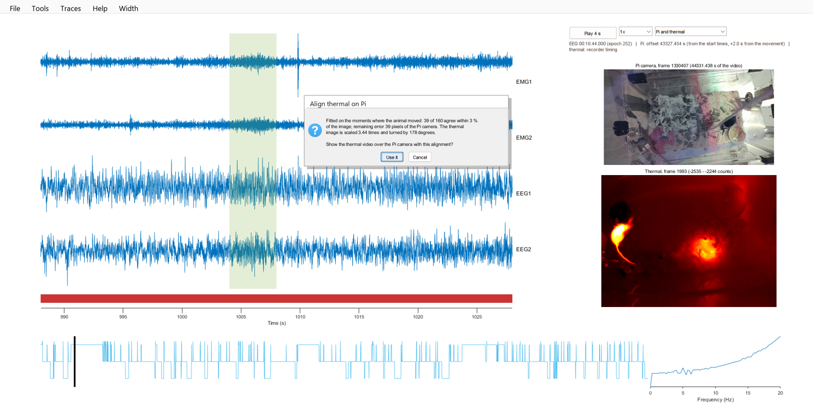

**Show > Thermal over Pi** then lays the warm parts of the thermal image over the camera. The slider in the column sets the opacity. The warm spot sits on the mouse in its nest:

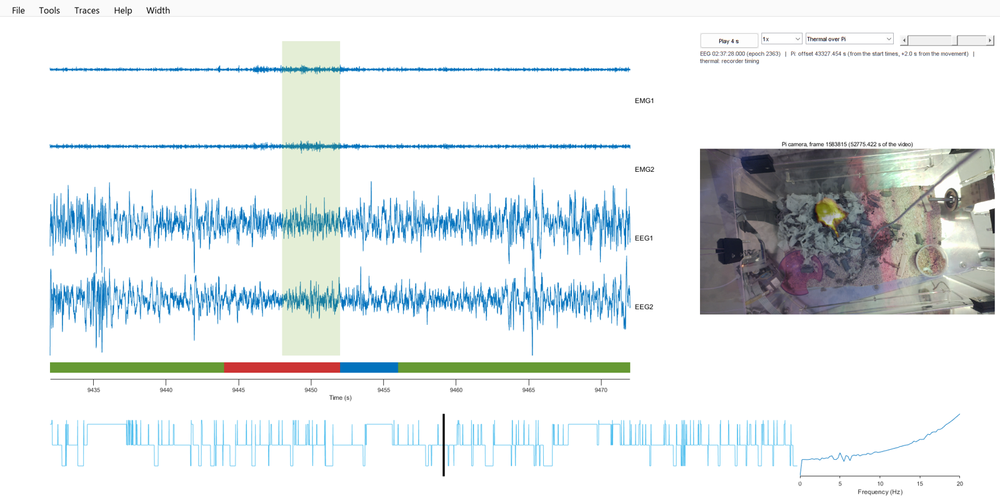

If you can see the same points in both videos (corners of the cage, for example), **Align thermal on Pi camera...** does the same from 3 or more points you click: first on the camera, Enter, then the same points in the same order on the thermal video.

## 10. ROIs: movement and breathing from the video

**Tools > Video > Add ROI...** draws a rectangle on one of the videos: choose the video, click two opposite corners, and give it a name.

- A **Pi ROI** gives, for every frame of the epoch, its movement (dx, dy in pixels, tracked from frame to frame) and its brightness.
- A **thermal ROI** gives its mean temperature (degrees, or counts without calibration).

The traces of the epoch are drawn under the videos. Click one to see its spectrum. Here a ROI on the nest of the sleeping mouse moves about 3 times per second: that is the breathing.

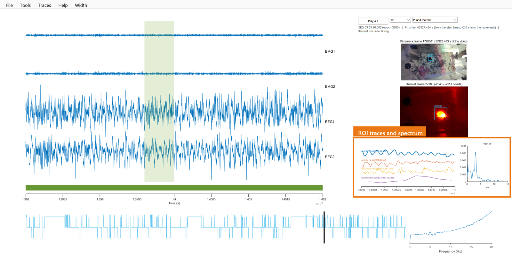

The ROIs are measured at every new epoch, which takes 1 to 2 s. Untick **Measure ROIs at every epoch** to score faster, and use **Measure ROIs of this epoch** when you need them. **Remove ROIs...** removes them.

## 11. Sensor data

The Raspberry Pi can record a respiration / heart sensor at the same time as the EEG.

**Tools > Sensor data > Import sensor CSV...**: select the `.csv` of the sensor (`.csv.gz` works too; a recording in several files: select them all, in order), then the traces to compare it with (here the two EMG traces).

The first time, the CSV is read into an `.h5` next to the EEG file (`<name of the CSV>_sensor.h5`). For these 5 hours (1.3 GB) this took a little over a minute. The next times, and when the scored file is opened again, that `.h5` is used. The CSV is not changed.

The comparison window opens on **Full recording**: for every 4-s epoch, the strongest peak of the sensor and of each trace in the respiration band (0.5–5 Hz) and the heart band (5–15 Hz). Click a point to see that epoch.

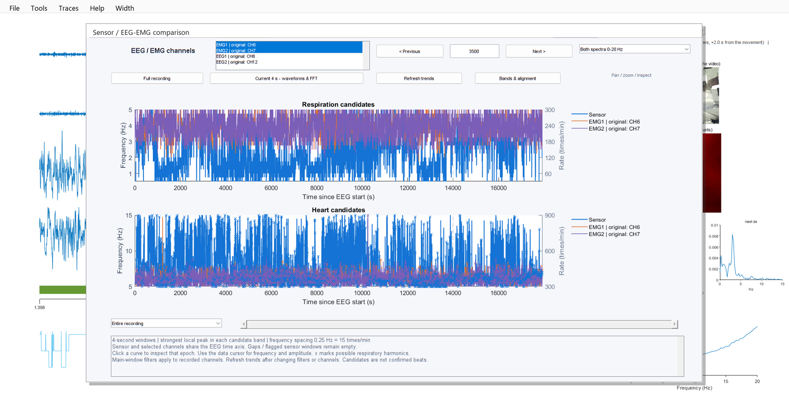

**Current 4 s - waveforms & FFT** shows the sensor and the traces of the epoch with their spectra. It follows the epoch of the main window.

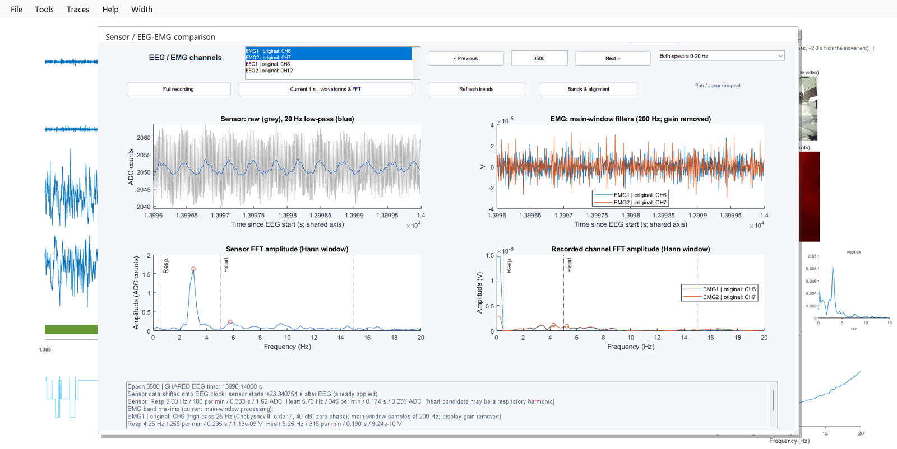

The sensor is placed on the EEG by the clock times of the two recordings. **Bands & alignment** changes the offset and the bands.

## 12. Summary figure

**Tools > Summary figure...** asks for an EEG channel and draws the whole recording in one figure: the hypnogram, the sigma activity of the EEG (10–15 Hz, spindles) in NREM sleep, the temperature, breathing and heart rate when the videos and the sensor are open, photometry when the file has it, the time spent in each state, the duration of the bouts, and the states hour by hour.

With a thermal video open, the temperature is the warmest spot of each frame. With an ROI on the nest in the Pi video, the breathing is measured in one epoch per minute: dots in the colour of the state, so you see the breathing of the sleeping mouse. With the sensor imported, its breathing and heart rate are shown too, one value per 4-s epoch. The first time, VeryScore3 asks before measuring the videos (here 12 to 19 min for the temperature and 16 to 28 min for the breathing, depending on the network drive); **File > Save** keeps the results.

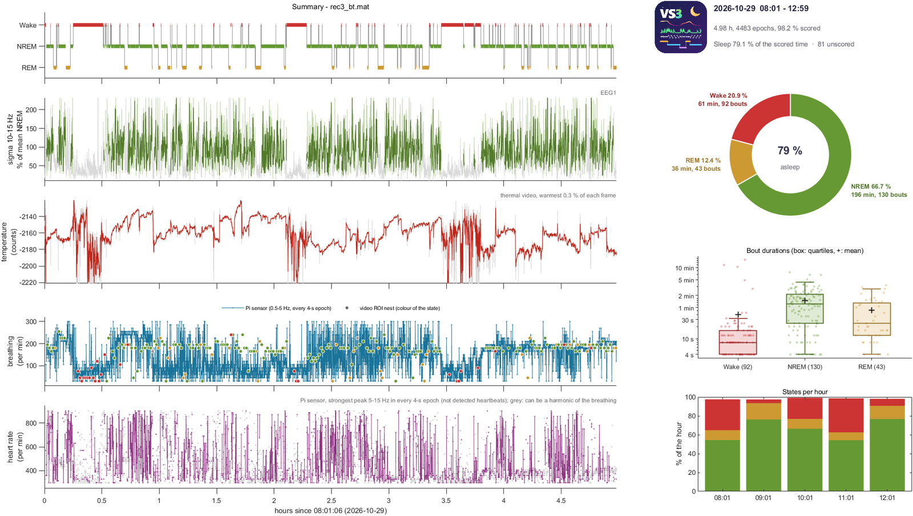

Here the video breathing is about 180 per minute in NREM sleep (middle half 165–195). The sensor's breathing jumps by about 30 per minute from one epoch to the next. In NREM it agrees with the video after 3 h of the recording, but between 1 and 2.5 h most epochs sit at 60–120. Its heart-band peak can be a harmonic of the breathing in half of the epochs (grey) and otherwise spreads over 360–690 per minute in NREM: a peak of the spectrum, not counted heartbeats.

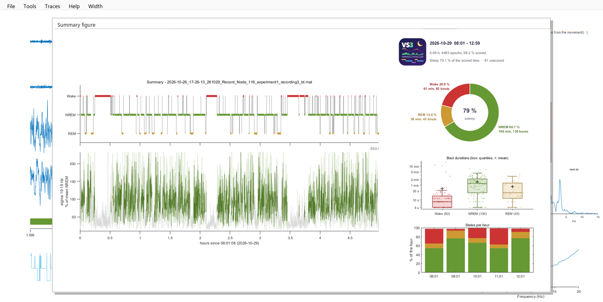

Click in it to see that moment in the main window. **Summary > Save as .fig and .png...** saves it next to the recording.

## 13. More tools

- **Tools > Take a snapshot**: the traces on screen in a new figure, to save or show (a nice spindle, a strange artifact).
- **File > Export displayed traces (.mat)...**: the traces as you see them (filters, bipolar traces, names) in a new `.mat` file, for your own analyses. The scored file is not touched.
- **Tools > Thermal video > Analyse video...**: the temperature of the animal from the thermal video, in a panel above the hypnogram. See [Thermal video](../README.md#thermal-video-temperature-panel) in the README.
- **Tools > Photometry > Selected trace to dF/F...**: dF/F of a fibre photometry channel recorded with the EEG. See [Photometry](../README.md#photometry-dff) in the README.
- **File > Import randomly**: select several files; they are given to you in a random order without their names, for blind scoring.
- **Help > About VeryScore3**: version and credits.

## 14. Keyboard cheat sheet

| Key | What it does |
|---|---|
| **w / n / r** | score wake / NREM / REM |
| **1 / 2 / 3** | artifact in wake / NREM / REM |
| **m** | microarousal |
| **f** | purple epoch (anything else) |
| **a / d** | previous / next epoch |
| **left / right arrow** | previous / next transition |
| **shift + w / n / r / m / f** | next epoch of that state |
| **shift + b** | next unscored (uncertain) epoch |
| **up / down arrow** | gain of all traces, or of the selected ones |
| **shift + up / down arrow** | move the selected trace up / down |
| **space** | play the epoch in the video column |

In the lab we score with Super Nintendo USB controllers and [JoyToKey](https://joytokey.net/en/). A configuration is in the VeryScore3 folder (`JTK_scoring.cfg`).

## 15. Tips and common problems

- **The names do not change after Reload Names from Infos.** Check that the field is called exactly `Channel` and that there is one name per trace, separated by commas.
- **The video does not match the traces.** Check the offset on a movement of the animal (section 9). Start times from different computers can be a few seconds apart.
- **Opening or analysing videos is slow.** The videos are read from where they are. On a network drive the first look at a long video takes minutes; a local copy is faster.
- **I changed a filter and want the raw trace back.** Select the trace, then **Traces > Reverse gain and filter**. **Traces > Reverse all changes** resets every trace.
- **Do I lose my scoring if I close VeryScore3?** Only what is not saved. File > Save often.
- **Can I go back to VeryScore2?** Yes: VeryScore3 reads and writes the same files.

The full description of every menu is in the [README](../README.md). The changes of each version are in the [CHANGELOG](../CHANGELOG.md).

**In the name of the Lüthi lab, we wish you a good scoring!**
